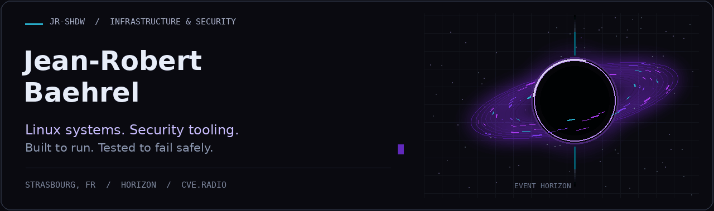
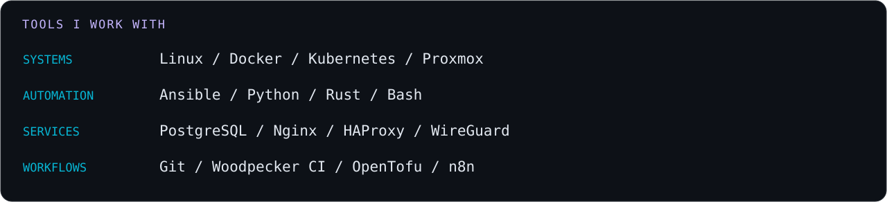

  

  <a href="https://github.com/JR-Shdw/Horizon"><strong>Horizon</strong></a> ·
  <a href="https://cve.radio"><strong>CVE.Radio</strong></a> ·
  <a href="https://www.baehrel.pro/cv_jr_full_en.html"><strong>English résumé</strong></a> ·
  <a href="mailto:cv@baehrel.gdn"><strong>Get in touch</strong></a>

## From production operations to security tooling

I'm **Jean-Robert Baehrel**, a Linux systems administrator and independent infrastructure & security consultant based in **Strasbourg, France**.

I spent seven years at a hosting provider, working with a team responsible for **more than 1,000 production servers** and services used by media organisations. Today, I work in healthcare IT operations and run **Resurgamus Informatique**, helping law firms and small businesses with infrastructure, security and migrations.

My perspective comes from operating systems that people depend on: on-call incidents, late-night migrations, access controls, backups and the work of keeping everything running. I bring that experience into the tools I build.

> I like software I can host, understand, operate and recover when things go wrong.

## Projects I build and operate

### [Resurgamus Horizon](https://github.com/JR-Shdw/Horizon)
**A self-hosted secrets vault for AI agents, infrastructure and automation.**

Horizon grew out of a practical need: give scripts, CI jobs and AI tools access to the credentials they need, with scoped permissions, revocation and an audit trail.

- Native MCP integration and a hub for connecting multiple MCP backends.
- Scoped tokens, namespace permissions and a credential proxy for configured API integrations.
- Encrypted storage, dynamic secrets, PKI, and high-availability mechanisms.
- Fault testing around database outages, network isolation, failover and sealing behaviour.

I use it in my own infrastructure. It is an ongoing **beta project**, with its security model and limitations documented in the repository.

**Python · Rust · PostgreSQL · MCP · AGPL-3.0**

[Explore the source](https://github.com/JR-Shdw/Horizon) · [Security model](https://github.com/JR-Shdw/Horizon/blob/main/docs/THREAT-MODEL.md) · [AI quickstart](https://github.com/JR-Shdw/Horizon/blob/main/docs/QUICKSTART-AI.md)

### [CVE.Radio](https://cve.radio)
**Vulnerability intelligence built for quick operational decisions.**

I built CVE.Radio to make vulnerability information easier to act on: affected products, severity, exploitation signals and available fixes in one place.

- French and English coverage, with RSS and JSON feeds.
- Exploitation, KEV and proof-of-concept indicators alongside CVSS and EPSS context.
- Automation-risk signals to help prioritise investigation and remediation.
- Automated collection and publishing workflows, connected to my own infrastructure.

**Vulnerability intelligence · Security automation · Decision support**

[Visit CVE.Radio](https://cve.radio) · [English RSS feed](https://cve.radio/data/feed-en.xml)

### More from my workshop

- **[Sextant](https://github.com/JR-Shdw/sextant)** — a lightweight catalogue for keeping track of projects, repositories, forges and hosting nodes.
- **[Horizon Terraform provider](https://github.com/JR-Shdw/terraform-provider-rhorizon)** — infrastructure-as-code tooling for the Horizon ecosystem.
- **Lich — work in progress:** a monitoring and alerting project in Rust, guided by a simple principle: one alert should lead to an action.

## What I bring to a team

- **Linux operations:** production administration, hardening, troubleshooting and incident response.
- **Automation:** Ansible, Python, Bash, CI/CD and repeatable deployments.
- **Infrastructure security:** secrets management, IAM, VPNs, firewalls and secure service configuration.
- **Reliability:** monitoring, encrypted off-site backups, migrations and recovery planning.
- **Client delivery:** turning requirements into working infrastructure, explaining trade-offs and documenting how to operate it.

  

## How I build

I use AI-assisted development alongside my operations experience. I focus on understanding the behaviour, testing failure cases and checking the boundaries between components. For security-sensitive tooling, I document what a control protects and where its limits remain.

My current interests include **AI and agent security**, MCP trust boundaries, credential isolation, security automation and reliable self-hosted infrastructure.

## Learning & background

My certification background includes **CompTIA Linux+, LPIC-1, Cisco CCNA and ISC2 SSCP**. I am currently preparing **ISO/IEC 27001 Lead Implementer** certification, connecting hands-on infrastructure work with security governance.

French is my native language. I use English for technical reading, writing and open-source work.

---

**Let's talk about Linux infrastructure, DevSecOps or security tooling.**

[English résumé](https://www.baehrel.pro/cv_jr_full_en.html) · [cv@baehrel.gdn](mailto:cv@baehrel.gdn) · [Public repositories](https://github.com/JR-Shdw?tab=repositories)
